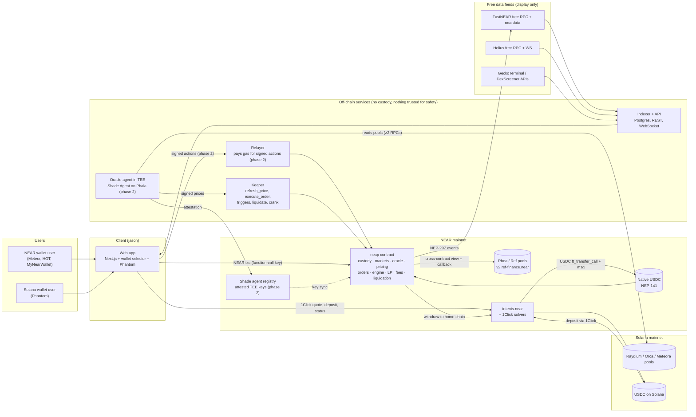
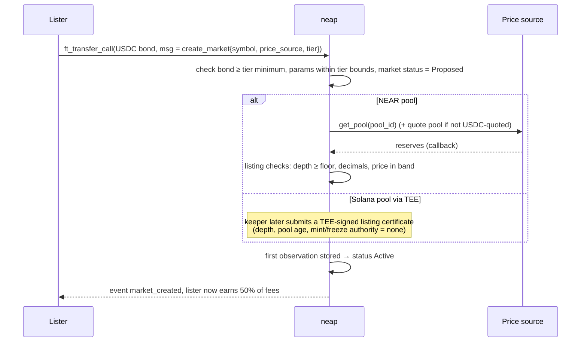

# Neap architecture (whole project)

Status: MVP architecture, 2026-11-10. Decisions are in `docs/decisions.md`; the contract in detail is in
`docs/contract.md`; the build order is in `docs/plan.md`.

## 1. The system on one page

Rendered: `docs/diagrams/system.png` (and `create-market.png`). The mermaid source below is the source of truth.

## 2. What runs where

| Piece | Where | Trust | Owner | Phase |
| --- | --- | --- | --- | --- |
| `neap` contract | NEAR mainnet, one account (e.g. `neap.<team>.near`) | Holds all funds. The only source of truth | Subh | 1 |
| Percolator engine | Linked Rust library inside `neap` | Verified math (Kani) | Subh (reuse) | 1 |
| Keeper | Any server, free tier is fine. Anyone can run more | None. Every call is checked on-chain | Subh | 1 |
| Indexer + API | Free-tier host + free Postgres | None. Display only, rebuildable from chain | Subh / jason | 1 |
| Web app | Vercel free tier | None. Builds transactions, never holds keys | jason | 1 |
| Oracle agent | Phala Cloud TEE (NEAR Shade Agent) | Code hash + liveness. Bounded by on-chain checks | Subh | 2 |
| Agent registry | NEAR contract (Shade Agent template) | Verifies TEE attestation, whitelists code hash | Subh | 2 |
| Relayer | Server with a NEAR key holding only gas money | None for funds (it can only delay, not forge) | Subh | 2 |
| NEAR Intents / 1Click | NEAR Foundation infra + solvers | Liveness of deposits and withdrawals only | external | 1 (NEAR) / 2 (Solana) |

## 3. The five flows

### 3.1 Create a market (any user)

### 3.2 Trade (two-step order)

`request_order` escrows margin and stores `{side, size, limit, expiry, request_block}`. A keeper then calls
`execute_order(id)`, which only fills against an observation **newer than `request_block`**, so neither user
nor keeper can pick a stale price. For NEAR-pool markets the keeper first calls `refresh_price`. For TEE markets it
submits the signed price in the same call. One NEAR receipt per step, about 2 to 4 s end to end.

### 3.3 Deposit and open from Solana (phase 2)

Phantom → 1Click quote (origin USDC or SOL on Solana → native USDC on NEAR) → the user sends to the deposit address →
solver delivers USDC → `ft_transfer_call` into `neap` with `msg = {owner: sol:<pubkey>, then: request_order{…}}` →
margin credited and the order queued. If the price moved past the limit or the order expired, funds simply stay as margin.

### 3.4 Close and withdraw to Solana (phase 2)

A signed action `close_and_withdraw{market, to: solana_address}` is relayed → reduce-only order fills → the
proceeds are debited from the user's wallet ledger first → `ft_transfer_call` to `intents.near` crediting the user's intents
account → 1Click withdrawal to their Solana address. A failed transfer goes to a claimable pending-refund ledger.

### 3.5 Liquidation

Keepers watch the indexer for accounts near maintenance margin and call `liquidate(market, account)`. The contract
re-checks eligibility with a fresh price. Liquidation fee 5% of the closed notional (capped): 60% to the caller,
40% to the market's insurance.

## 4. Price sources

| Source | Read by | Freshness rule | Phase |
| --- | --- | --- | --- |
| `NearPool { dex, pool_id, quote_pool? }` | `neap` itself: cross-contract `get_pool` view, then `on_price_read` callback | Observation is the callback's block. Age ≤ max age to trade | 1 |
| `Tee { chain: Solana, pools[] }` | Oracle agent in TEE, ed25519-signed, verified in `neap` with `env::ed25519_verify` against a registered key | `seq` and `source_ts` strictly increase; age ≤ 5 s | 2 |

Both produce the same `Observation { price_e6, liquidity_usd, source_ts, seq, block }`, so pricing, orders and the
engine never care where the price came from. The engine price then walks toward the observation along a capped
staircase (max move per block), so a manipulated spike can't jump the mark.

## 5. Money

- **Collateral:** native USDC on NEAR only. Anything else (SOL, other tokens, other chains) is converted to USDC
  **before** it reaches the contract: by 1Click solvers for cross-chain, or by a Rhea swap in the client for
  NEAR tokens. The contract never holds a non-USDC token.
- **Fees:** trading 0.05% → lister 50%, seed LP 30%, insurance 10%, protocol 10%. Liquidation 5% → liquidator 60%,
  insurance 40%.
- **Who pays winners:** the market's seed pool (it took the other side), then insurance. If both are exhausted,
  winners' unrealized profit is haircut pro rata (Percolator `credit_rate`). Losses never spill into other markets.

## 6. Data and indexing (free tier only)

| Need | Source | Free limits we design around |
| --- | --- | --- |
| Neap events (fills, orders, liquidations, markets) | FastNEAR `neardata` block stream filtered to our account, plus `free.rpc.fastnear.com` for views | ~180 req/min per IP on neardata |
| NEAR token list and prices for the "create market" picker | Rhea/Ref indexer API + GeckoTerminal `near` network | GeckoTerminal ~30 calls/min |
| Solana live coin feed (trending, pools, candles before listing) | GeckoTerminal / DexScreener public APIs | Cache 30–60 s server-side, never call from the browser |
| Solana pool state for listed markets (live price on screen) | Helius free plan WebSocket `accountSubscribe` on listed pools only | 1M credits/mo, 10 rps, 5 WS connections, WS metered per MB |
| Candles for listed markets | Built by the indexer from our own on-chain observations | No external dependency |
| Storage | Free Postgres (Neon or Supabase free tier) | Prune raw blocks, keep events |

The indexer is display-only. If it is wrong or down, nobody loses money: the contract re-checks everything.

## 7. Repository layout

The developer chooses the folder structure. The only fixed points: the engine stays a separate crate (copied from
`moka-research/percolator/engine`, provenance in its `UPSTREAM.md`), the contract is its own crate, and off-chain
services never share code with the contract except a generated ABI or types package.
