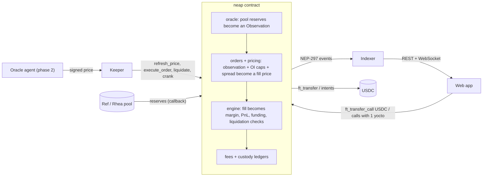

# Neap components

Maps the usual perp-DEX components (trading, risk, oracle, liquidation, funding, custody, indexer) onto Neap.
Normative detail is in `contract.md`; build order is in `plan.md`. Status as of 2026-11-11.

## Component map

| Component | In Neap | Where it lives | Status |
| --- | --- | --- | --- |
| Trading engine | No order book. Every fill is trader against the market's pool. Market orders and TP/SL/limit orders go through request, then execute. | Contract: `orders`, `pricing` modules (steps 1.5 to 1.7) | Only the old direct `trade()` exists |
| Risk engine | Percolator: equity, margin, PnL, liquidation eligibility, haircut. | `crates/engine` (unchanged math), called from `crates/neap/src/exchange.rs` | Done (inherited) |
| Margin model | Isolated per market, USDC only. | Contract and engine | Done (inherited) |
| Oracle infra | Pool price becomes an `Observation`, then an EMA, then the capped staircase. A stale price blocks opens, then forces reduce-only. | Contract `oracle` module (1.2, 1.3); off-chain TEE agent for Solana (2.1, 2.2) | `Observation` type only; rules not built |
| Liquidation engine | `liquidate()` is permissionless. The contract re-checks eligibility, the caller gets 60% of the fee, and the team runs a keeper as fallback. | Contract (1.8) plus keeper (1.10) | Math inherited; reward split not built |
| Funding engine | Skew funding, lazy: a cumulative index settled when an account is touched. | Inside the engine | Done (inherited) |
| Settlement and custody | Collateral sits in the contract's USDC balance, in ledgers (wallets, vaults, refunds, fees). Admin has no path to balances. | Contract `custody` | Mostly done; `pending_refunds` and withdraw-to-intents still to add |
| Indexer and real-time | Built off the NEP-297 events. Postgres, REST and one WebSocket. | Off-chain service (1.11) | Not started |
| Extras | Relayer for Solana-signed actions, Intents (1Click) for cross-chain, lister bond and fee ledgers. | Relayer (2.3); contract | Not started |

## Folder structure

```
neap/
  crates/
    engine/          Percolator risk engine (no_std, do not edit math)
    neap/            THE smart contract (compiles to neap.wasm)
      src/
        model.rs       Owner, Market, Observation, Mode, Tier   (done)
        policy.rs      pure pricing/funding/LP math, Kani-provable
        exchange.rs    engine glue and call ordering
        contract.rs    storage, auth, entry points (split into custody, markets, oracle,
                       orders, fees, keeper_api, admin as each step touches them)
      tests/ sandbox/
  services/          off-chain, never holding funds
    keeper/          refresh_price, execute_order, triggers, liquidate, crank
    indexer/         events to Postgres, REST and WebSocket API
    oracle-agent/    Shade Agent for Solana pools (phase 2)
    relayer/         forwards signed Solana actions (phase 2)
    types/           Rust crate neap-types: types shared by the services (no near-sdk)
  web/               frontend (jason, not Rust)
  docs/  HANDOFF.md
```

All off-chain services are Rust (members of the root Cargo workspace; the crates are empty skeletons until their plan step).

Hard rule (`architecture.md` §7): the engine is its own crate, the contract is its own crate, and off-chain services
share nothing with the contract except plain types (`neap-types`, no near-sdk).

## Data flow



## Inputs and outputs

| Component | Input | Output |
| --- | --- | --- |
| Oracle | Pool reserves (or a signed price) | `Observation {price, liquidity, ts, seq, block}`, or a mode change if stale |
| Pricing | Observation, skew, size, OI caps | Fill price, spread, and a `quote()` the UI can show |
| Orders | User request, then a newer observation | Fill, or expiry and escrow release |
| Engine | A fill, a price, an account | New margin, PnL and position; liquidation eligibility; funding index update |
| Liquidation | Account state, fresh price | Closed position, fee split (60% caller, 40% insurance) |
| Fees | Fill and liquidation fees | Claimable ledgers for lister, LP, insurance and protocol |
| Custody | USDC from `ft_on_transfer` | Wallet credit; withdrawals debit first, then send |
| Indexer | Events | Candles, positions, order and fill history, API and WebSocket |
| Keeper | Indexer, or contract views | Transactions only. The contract re-checks everything. |
