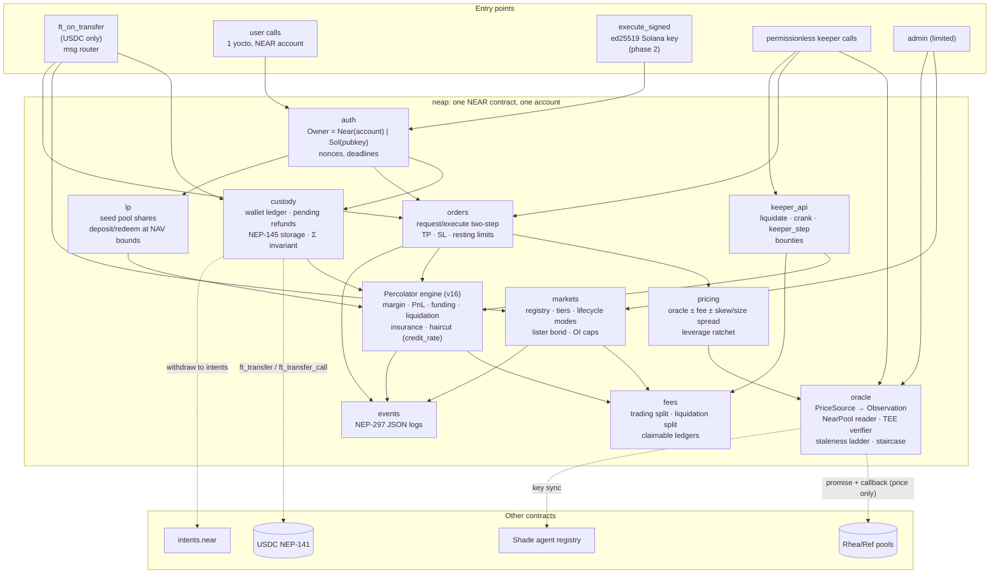

# The `neap` contract

Status: MVP spec, 2026-11-10. Normative: if code and this file disagree, fix one of them in the same PR.
Starting code: `moka-research/percolator/near` (wrapper) + `percolator/engine` (risk engine), already ported and
tested on NEAR. Section 7 lists exactly what to add.

## 1. Contract diagram

Rendered: `docs/diagrams/contract.png`. The mermaid source below is the source of truth.



**Atomicity rule.** Every engine call happens inside one receipt with no promise in between. The only promises
are: reading a NEAR pool (the callback writes **only** an observation, never engine state), sending USDC out
(debit first, re-credit or park on failure), and key sync. NEAR does not roll back across receipts, so any value-bearing
state change must finish before a promise is created.

## 2. Answers to the components map (Subh's research)

| Component | What Neap does | Inside the contract? |
| --- | --- | --- |
| **Trading engine** | No CLOB. Pool-to-peer: every fill is `trader ↔ market seed pool` at `oracle ± spread`. Order types: market (IOC with limit), resting limit, TP and SL, all reduce-only where they close. Two-step request/execute stops stale-price picking. Partial fills not needed (fills are all-or-nothing within the OI cap). Post-only and FOK are meaningless without a book. | Yes (`orders`, `pricing`) |
| **Risk engine** | Percolator v16, unchanged math. Computes equity, IM/MM, uPnL, realized PnL, liquidation eligibility, max leverage. Profit is a junior claim that matures (warmup) and is haircut if unbacked. | Yes (`engine`) |
| **Margin model** | Isolated per market. One portfolio per (user, market). USDC only. | Yes |
| **Oracle infrastructure** | Accuracy: liquidity-weighted pool price, EMA. Update frequency: on demand per order (NEAR) or every few seconds (TEE). Confidence: liquidity and cross-pool deviation in the observation. Freshness: age limits per action. Stale ≥10 s → no new opens; ≥60 s → reduce-only; ≥1 h → recovery. Outliers: the staircase cap (max move per block) means the engine price never jumps; a move over the band → reduce-only. No synthetic or fallback price, ever. | Verification and rules yes; reading Solana no (TEE) |
| **Liquidation engine** | Hybrid: `liquidate` is permissionless; the team runs a keeper as fallback. The contract re-checks eligibility itself. Fee 5% of closed notional (capped) → 60% caller, 40% insurance. The engine handles partial vs full close and bad debt. | Yes |
| **Funding engine** | Skew funding: the crowded side pays the pool, rate ∝ pool imbalance / OI, capped per slot. Lazy: cumulative index in the engine, settled when an account is touched, never a per-user loop. | Yes (engine) |
| **Settlement and custody** | See the Q&A below. | Yes |
| **Indexer and real-time data** | Off-chain, rebuildable from NEP-297 events. | No |

**Settlement and custody Q&A**

| Question | Answer |
| --- | --- |
| Where is collateral stored? | In the `neap` contract's USDC balance. Internally: wallet ledger (idle) + per-market engine vaults (margin, LP, insurance). Invariant: `USDC.ft_balance_of(neap) ≥ Σ wallets + Σ vaults + Σ pending_refunds + Σ claimable fees`. |
| How are deposits credited? | Only through `ft_on_transfer` from the configured USDC contract. `msg` decides the destination: wallet, margin, deposit-and-open, LP, or market-creation bond. An unknown msg is refunded in full. |
| How are withdrawals authorized? | NEAR users: a call from the owner account with 1 yoctoNEAR (full-access key). Solana users: an ed25519 signature over `{action, nonce, deadline, contract_id}`. Only free margin above IM, excluding unmatured profit. |
| Where are realized profits paid from? | From the losing side through the engine: in pool-to-peer that is mostly the seed pool, then insurance. Profit becomes withdrawable after warmup and `convert_pnl` (the keeper and frontend convert on close). |
| How are losses accounted? | The engine moves the loser's capital to the counterparty. Bad debt hits insurance, then a haircut on winners' junior claims (`credit_rate`). Never another market. |
| What if liquidity is insufficient? | OI caps stop it building up (per side, per account, tied to seed and pool depth). If it happens anyway: haircut, plus market → reduce-only. |
| Can the operator move user funds? | No method exists for it. Admin can only tighten risk (pause opens, force reduce-only, lower caps) and rotate the oracle registry. The upgrade key is the residual risk: disclosed for the hackathon, then a multisig with a timelock, later a locked contract. |
| What if off-chain and on-chain disagree? | There is no off-chain matching. The chain is the only state; the indexer is rebuilt from events. |

## 3. State (logical)

```text
Contract
  owner, pauser                          // admin roles (limited powers, §6)
  usdc: AccountId                        // native USDC NEP-141
  intents: AccountId                     // intents.near (phase 2)
  agent_registry: AccountId              // Shade registry (phase 2)
  tee_keys: Map<PublicKey, KeyInfo>      // cached from registry, with expiry
  wallets: Map<Owner, u128>              // idle USDC
  pending_refunds: Map<Owner, u128>      // failed outbound transfers
  nonces: Map<Owner, u64>                // signed-action replay protection
  markets: Vector<Market>
  groups: Map<MarketId, EngineGroupBytes>
  portfolios: Map<(MarketId, Owner), PortfolioBytes>
  orders: Map<OrderId, Order>            // pending two-step + conditional
  fee_ledgers: Map<(MarketId, Payee), u128>

Market
  symbol, tier, mode (Proposed | Active | ReduceOnly | PriceUncertain | Recovery | WindDown | Closed)
  price_source: NearPool{dex, pool_id, quote_pool?} | Tee{chain, pools[]}
  base_decimals: u8 (NearPool only; `CreateMarket.base_decimals`, default 6, max 24; stored per market.
                 Pool price = usdc_atoms * 10^base_decimals / token_atoms, rounded down)
                | Pushed   // transitional (steps 1.1-1.2): the trusted `oracle` account; deleted in 1.3
  observation: {price_e6, liquidity_usd, source_ts, seq, block}
  ema_e6, engine_target, staircase state
  lister: Owner, bond: u128
  oi_cap_long, oi_cap_short, per_account_cap
  params: tier-bounded MarketParams (IM, MM, fees, spread, envelope)
  lp_total_shares

Owner = Near(AccountId) | Sol([u8; 32])
```

## 4. Methods

| Group | Method | Caller | Notes |
| --- | --- | --- | --- |
| custody | `ft_on_transfer(sender, amount, msg)` | USDC contract only | msg: `Wallet` · `Margin{market}` · `DepositAndOpen{market, order}` · `Lp{market}` · `CreateMarket{…}` · `For{owner: Sol(pk), then}` (from intents) |
| custody | `withdraw(amount, to?)` | owner | `to = Near(account)` → `ft_transfer`; `to = Intents{account}` → `ft_transfer_call` to intents.near |
| custody | `claim_refund()` | owner | Pays pending_refunds |
| custody | `storage_deposit` / NEP-145 | anyone | Covers wallet + portfolio storage |
| markets | `create_market` (via `ft_transfer_call` bond) | anyone | Tier picked by lister. Params must fall within tier bounds. Starts `Proposed` |
| markets | `activate_market(id)` | keeper | Needs a valid first observation and listing checks passed (NEAR pool: in callback; TEE: signed listing certificate) |
| oracle | `refresh_price(market)` | anyone | NEAR pool only: promise `get_pool` → `on_price_read` (private) stores the observation |
| oracle | `submit_price(market, signed_obs)` | anyone | TEE only: checks key, signature, seq, ts, band |
| oracle | `sync_tee_keys()` | anyone | Pulls registered keys from the agent registry |
| margin | `deposit(market, amount)` / `withdraw_margin(market, amount)` | owner | Already in the port |
| orders | `request_order(market, side, size, limit, expiry, reduce_only)` | owner | Escrows margin, stores request_block |
| orders | `place_conditional(market, kind = TP/SL/Limit, trigger, size, limit?)` | owner | Storage charged; max 30 days |
| orders | `cancel_order(id)` | owner | Releases escrow |
| orders | `execute_order(id)` / `execute_conditional(id)` | anyone (keeper) | Needs observation.block > request/arm block; trigger crossed; within limit; else no-op or expire |
| lp | `lp_deposit` / `lp_redeem` | anyone | Already in the port (NAV bounds). Redeem after a 24 h delay |
| keeper | `liquidate(market, account)` | anyone | Pays the caller 60% of the liq fee |
| keeper | `crank(market)`, `keeper_step(market, account)`, `convert_pnl_for(market, account)` | anyone | Bounded work per call |
| fees | `claim_fees(market)` | lister / protocol | Pays the fee ledger via engine insurance-surplus withdrawal |
| auth | `execute_signed(owner_pk, action, nonce, deadline, sig)` | relayer (anyone) | Phase 2. Verifies ed25519 over borsh(action, nonce, deadline, contract_id) |
| admin | `set_mode(market, ReduceOnly / PriceUncertain)`, `pause_opens`, `lower_caps` | pauser | Tighten only |
| admin | `set_tier_bounds`, `set_agent_registry`, `set_roles` | owner | No access to user balances |
| views | `get_market`, `get_account`, `get_order`, `quote(market, side, size)`, `get_wallet`, `get_fee_ledger` | anyone | `quote` returns price, fee and spread so the UI shows exactly what will fill |

## 5. Pricing and parameters

`exec = oracle_mark × (1 ± (spread_min + k_skew·|skew_after|/OI_cap + k_size·size/OI_cap))`, rounded against the
taker. Trades that reduce skew pay only `spread_min`. The trading fee (0.05%) is charged on notional by the engine.
Leverage ratchet: `Lmax = max(1, L0 · (1 − skew/OI_cap))`.

| Param | Major tier (SOL, NEAR) | Long-tail tier |
| --- | --- | --- |
| Max leverage (IM) | 10x (10%) | 4x (25%) |
| Maintenance margin | 8% | 15% |
| Trading fee | 5 bps | 5 bps |
| spread_min / skew spread at cap | 5 / 50 bps | 20 / 150 bps |
| Liquidation fee (cap) | 5% of closed notional | 5% |
| Max move per block × accrual window | 10 bps × 20 blocks | 30 bps × 20 blocks |
| Envelope check at creation | `move×window + funding + liq_fee ≤ MM` → 2% + ~0.5% + 5% ≤ 8% ✓ | 6% + ~0.5% + 5% ≤ 15% ✓ |
| OI cap per side | `min(seed / max_adverse_move, α × pool_depth)`, α = 2% | same, α = 2% |
| Per-account cap | 25% of OI cap | 25% |
| Order expiry | 30 s | 30 s |
| Min lister bond (demo) | protocol-listed | 50 USDC |
| Demo TVL cap per market | 50 USDC of seed | 50 USDC |

**Why MM is 8% and not 5%:** the 5% liquidation fee plus the price staircase must fit inside maintenance margin, or a
liquidation could leave bad debt. If 10x feels tight, lower the liquidation fee, not the envelope.

Fee split (wrapper ledgers, paid from engine insurance surplus): trading fee → lister 50%, seed LP 30%,
insurance 10%, protocol 10%. Liquidation fee → caller 60%, insurance 40%.

## 6. Invariants (each needs a test or a Kani harness)

1. **Custody:** USDC held ≥ every ledger summed (wallets, vaults, pending refunds, claimable fees). Checked after every call in tests.
2. **Isolation:** no call touches more than one market's group and portfolios.
3. **No stale fills:** `execute_*` only uses an observation with `block > request_block` (or the arm block for conditionals).
4. **Monotone oracle:** `seq` and `source_ts` strictly increase per market. Future timestamps beyond a 2 s skew are rejected.
5. **No straddled promises:** no engine mutation in a callback, and no engine mutation before a promise in the same call
   unless the debit happens first and failure is handled.
6. **Admin can't take funds:** no admin method changes a wallet, portfolio, vault or fee ledger balance.
7. **Signed actions:** each nonce is used once; deadline enforced; signature covers contract id + action + nonce.
8. **Fees conserve:** Σ fee ledgers paid ≤ fees accrued; splits sum to 100% with rounding dust to insurance.
9. **Price source immutability:** a market's price source can't change after activation (a new market generation instead).

### Rules added 2026-11-18 (review, `docs/review-2026-11-18.md`)

10. **Engine vault link:** `custody_vaults` equals the sum of engine vaults. Any amount credited to a wallet from a
    market (fees, liquidation reward) is withdrawn from the engine first.
11. **Mode gates fills:** opens fill only in `Active`; `ReduceOnly` fills closes; no other mode fills. The rule is the
    same for orders and conditionals. Margin top-up works in every mode where liquidation runs.
12. **Caught up:** every method except `crank` requires the engine to have reached the current block.
13. **No action on an hour-old price** where the result depends on the mark: fills, liquidation, `keeper_step`,
    margin withdrawal with an open position, LP deposit or redeem while the pool has exposure.
14. **OI caps and spread use the traders' net position** per side (the pool's exposure). The pool mirrors every fill,
    so the engine's long and short OI are always equal. A fill that shrinks the net is never refused by a cap and
    pays `spread_min`. Conditionals obey the caps.
15. **One pool sample per block** for `NearPool` markets. A reading outside the 20% band is not an observation, but
    the EMA steps toward it, clamped to the band edge.
16. **Admin calls need 1 yoctoNEAR.** `Major` tier listings are owner-only. Symbols are 1 to 32 of letters, digits,
    `-`, `_`, `/`. A `Tee` source names 1 to 8 pools of at most 64 bytes. A refused listing is refunded in full.
17. **Sizes** are at most `i128::MAX`. A TP/SL fills for at most the remaining position.

## 7. Gap list: what the port has vs what to build

| Area | In `percolator/near` today | To build |
| --- | --- | --- |
| Engine, margin, funding, liquidation math | ✅ Done, Kani + property tests, gas ≤ 7 TGas | Keep as is |
| Custody, wallet ledger, debit-first withdraw | ✅ | Add `pending_refunds` (today it re-credits the wallet, which is fine; keep it) and withdraw-to-intents |
| LP pool shares (NAV bounds) | ✅ | 24 h redeem delay |
| Market creation | Owner-only, `init_price` input | Anyone + bond via `ft_transfer_call`, `PriceSource` input, tiers, `Proposed → Active` |
| Oracle | One trusted `push_price` account | `NearPool` reader (promise + callback); TEE signature verify (phase 2); EMA; stale ladder modes |
| Pricing | Flat `spread_bps` | Skew + size spread, leverage ratchet, OI caps |
| Orders | Direct `trade()` | Two-step request/execute, conditional TP/SL/limit, reduce-only flag |
| Fees | Engine fee → insurance | Wrapper fee ledgers (lister / LP / insurance / protocol), `claim_fees` |
| Liquidation reward | None paid to the caller | 60/40 split, paid in the same call |
| Identity | NEAR accounts only | `Owner::Sol(pk)` + `execute_signed` (phase 2) |
| Admin | Owner can set oracle/owner | Pauser role, tighten-only methods, no fund access |
| Events | `fill` only | NEP-297 for every state change the UI needs (§8) |
| F-1 (unconverted profit backing expires) | Open | Keeper calls `convert_pnl_for` after each close; UI does too |

## 8. Events (NEP-297, `standard: "neap"`, `version: "1.0.0"`)

`market_created`, `market_activated`, `market_mode_changed`, `price_observed`, `order_requested`, `order_executed`,
`order_cancelled`, `order_expired`, `conditional_placed`, `conditional_triggered`, `fill`, `liquidation`, `funding_settled`,
`deposit` (wallet to margin), `margin_withdraw`, `wallet_deposit`, `withdraw`, `withdraw_failed`, `refund_parked`,
`lp_deposit`, `lp_redeem`, `fees_accrued`, `fees_claimed`, `oi_caps_changed`, `owner_changed`, `oracle_changed`,
`pauser_changed`. Not emitted yet: `order_executed` (use `fill`), `funding_settled`, `refund_parked`, `fees_accrued`.
Every event carries `market`, `owner` (if any), integer amounts as strings, and `block`.
